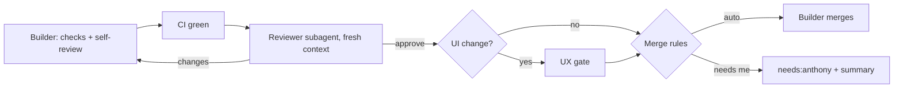

# Fleet: how agents work my backlogs

I am the product owner. Agents plan, build and review; I decide what gets built
and what merges. This file is the standard every repo in the fleet follows, and
every cloud session loads it through [`session-start.sh`](session-start.sh).

Plan and reasoning: the "Agent fleet plan" doc in the AI Assistant project.

## Where things live

- **Ideas** start in `brignano/ideas` (`inbox/` → `proposals/` → `building/`).
  A brief reaching `building/` is the signal to break it into issues.
- **Work items** are GitHub Issues in the repo that owns the code.
- **The board** is one GitHub Project, [**Fleet**](https://github.com/users/brignano/projects/1),
  across every fleet repo. Status columns: Proposed, Ready, Building, In review,
  Blocked, Done. Priority: P1, P2, P3. It is my view. Agents can't read or write it
  (cloud sessions only reach repo-scoped APIs), so **labels are what agents act
  on**, and `fleet-board` moves the cards to match them.
- **What's on the board** is listed in [`board.yml`](board.yml): driftwood,
  guidebook, sites, brignano.io, homelab, design, ai-tools and breakeven. The
  [`fleet-board`](../.github/workflows/fleet-board.yml) workflow adds every
  open issue and PR in those repos every 15 minutes, fills the board's Priority
  field from each card's `priority:` label, and gives `agent:ready` (dropping
  `proposed`) to any card I move to **Ready**. It sets every open card's
  **Status from its labels** (see "Status, priority and blocked"), labels
  untriaged issues `proposed`, and flags stale claims (see "Claiming an
  issue"). It never removes a card,
  using the `FLEET_PROJECT_TOKEN` secret: a classic token with `project` and
  `repo` scopes. A repo earns a spot when agents ship work there and it has a
  real backlog. **life, people and ideas never go on the board.** The
  "By repo" view groups cards by Repository.

## Every repo loads this file

Project instructions are set by hand per project and drift; this file doesn't.
So **every repo I own runs the fleet hook**, which loads this README and the
global AGENTS.md into each cloud session. One edit here then reaches every
project.

- The hook is [`hook/session-start.sh`](hook/session-start.sh), wired by
  [`hook/settings.json`](hook/settings.json). Copy both into the repo as
  `.claude/hooks/session-start.sh` and `.claude/settings.json`. If the repo
  already has a SessionStart hook, add the fleet block to the end of it and
  keep one hook.
- Repos with it today (checked 2026-11-01): driftwood, guidebook, sites,
  brignano.io, homelab, design, breakeven, life, card. ai-tools itself doesn't
  need it: it is where the hook's payload lives. Any other repo gets a
  `proposed` issue to add it.

**New repo checklist** (the planner's first run does this):

1. Add the fleet hook (above).
2. Labels arrive on their own: the `fleet-labels` workflow syncs every repo I
   own on Mondays. Run it by hand to get them sooner.
3. If it will have a real backlog, add it to [`board.yml`](board.yml).
4. Nothing to paste into the project's instructions: the hook carries the
   rules.

## Labels

One set in every repo, defined in [`labels.yml`](labels.yml). **Use only labels
from that file.** Never create a label from an issue or PR; if one is missing,
add it to `labels.yml` in a PR. The [`fleet-labels`](../.github/workflows/fleet-labels.yml)
workflow syncs the file to every repo I own on merge and every Monday
(`python3 fleet/sync-labels.py` previews it locally).

| Label | Meaning | Who sets it |
|---|---|---|
| `proposed` | An agent suggested it. Nobody works on it. | Planner |
| `agent:ready` | Spec approved. A builder may take it. | **Only me** (or I move the card to Ready) |
| `agent:working` | A session claimed it; every other session skips it. | The session that claims it |
| `agent:pause` | Leave it alone until I remove this. | Me |
| `needs:anthony` | Blocked on a decision, account or hardware from me. | Any agent |
| `blocked` | Waiting on another issue or PR, named in a `Blocked by owner/repo#N` line in the body. | Any agent |
| `priority:p1` / `p2` / `p3` | Source of truth for priority; `fleet-board` copies it to the board's Priority field. Every open issue has one. | Whoever files it proposes, I confirm |
| `risk:low` / `risk:high` | Decides merge rules. | Planner proposes, I confirm |
| `size:s` / `size:m` | Agents take S and M only. Bigger gets split. | Planner |
| `type:bug` / `feature` / `chore` / `docs` | What kind of work it is. | Whoever files it |

Every issue an agent files carries `proposed`, one `priority:`, one `type:`,
one `size:` and one `risk:` label. Dependabot keeps its own (`dependencies`, `javascript`, …).

Default issue forms (task, bug, feature) are in [`issue-forms/`](issue-forms/)
and published to `brignano/.github` by [`bootstrap-dotgithub.sh`](bootstrap-dotgithub.sh).

## An issue is a spec

Every issue an agent writes uses this shape. It is what lets the builder work
without re-planning and the reviewer judge without asking me.

```markdown
## Problem
What is wrong or missing, and who it hurts. One paragraph.

## Acceptance criteria
- [ ] Observable outcome, checkable from the diff or a command
- [ ] ...

## How to verify
The exact commands or checks that prove it (the repo's own, e.g. `npm test`).

## Out of scope
What this deliberately does not do.

## Notes
Files likely involved, links to the brief or TSD, risks.
```

Size S: the issue body is the spec. Size M: also a short proposal in the
repo's `proposals/`, linked from the issue. Anything bigger is split before it
is Ready.

## Proposals

Design work lives in `proposals/` at the repo root, never in `docs/`. `docs/`
is for documentation a user reads (and a future doc site), and a proposal is a
decision record that may never ship. Keeping them apart means a doc site can be
built from `docs/` without dragging in rejected designs.

- **One file per proposal**, `proposals/<slug>.md`, starting with a status
  line: `Status: proposed | accepted | building | done | rejected`, and the
  issue that tracks it.
- **Every proposal has an issue.** The issue is the work item and the source
  of truth for whether it is Ready; the proposal is the reasoning behind it.
  A proposal with no issue is an orphan, and the reviewer rejects the PR that
  adds one.
- **`proposals/README.md` is the index**: one row per proposal with its
  status, tracking issue and the issues it was split into. Any PR that adds a
  proposal or changes its status updates the index in the same PR.
- A proposal that writes "proposed issues" at the end gets them filed by the
  planner as `proposed` once the proposal merges, and the index links them.

Index shape:

```markdown
# Proposals

| Proposal | Status | Issue | Split into |
|---|---|---|---|
| [AWS provider](aws-provider.md) | proposed | #41 | |
```

**Definition of ready:** problem, acceptance criteria, how to verify, size and
risk labels, and my `agent:ready`. Missing any one, a builder skips it.

**Definition of done:** every acceptance box ticked in the PR body, the repo's
checks green, the review gates passed (see "Review and merge"), and the PR
merged, by me or, where the merge rules allow it, by the builder.

## Status, priority and blocked

I should be able to open the board, or ask any project "what's next", and see
at a glance what is moving, what is waiting on me and what comes next. So
every open issue carries enough labels to say all three, and the board
follows the labels.

**Status follows labels.** `fleet-board` sets each open card's Status every
15 minutes. Labels win over where a card sits; the one exception is dragging
a card to **Ready**, which adds `agent:ready`.

| Labels on the issue | Status |
|---|---|
| `blocked` or `needs:anthony` (beats everything below) | Blocked |
| `agent:working` and an open PR links it | In review |
| `agent:working` | Building |
| `agent:ready` | Ready |
| `proposed` | Proposed |
| no workflow label at all | gets `proposed`, then Proposed |
| `agent:pause` or `lead` | left where I put it |
| closed | Done (GitHub's built-in workflow) |

Open PRs sit in In review. To unblock, remove the label; to un-ready, remove
`agent:ready`. Dragging a card anywhere but Ready gets undone on the next sync.

**Every open issue has a priority.** Whoever files it proposes one; I change
it when I disagree. Priorities have to rank, or they say nothing:

- `priority:p1`: what this repo should do next. **At most 2 open per repo.**
  Adding a third means moving one down, in the same change.
- `priority:p2`: after that, this month.
- `priority:p3`: someday. Fine to have many, but a repo where every issue is
  P3 has no plan; its planner run fixes that first.

**Blocked has two kinds**, so I can tell what I owe from what is just queued:

- `needs:anthony`: only a person can move it (a decision, account, secret,
  hardware or a merge). The issue or PR says, in its last comment, exactly
  what I need to do, in one line.
- `blocked`: it waits on other work. The body has a `Blocked by
  owner/repo#N` line. When that closes, whoever closes it (or the next
  planner run) removes `blocked` from the issues it held up.

Something blocked on me *and* other work gets both.

**Backlog health.** Every Sunday, before the review, the
[`fleet-backlog-health`](../.github/workflows/fleet-backlog-health.yml)
workflow writes one "Fleet backlog health" issue in ai-tools, edited in
place each week. Per repo it lists: issues that look done (a merged PR
mentions them, no open PR does), no priority, more than 2 P1s, `blocked`
with no "Blocked by" line, and idle for 30 days. It never changes the issues
themselves. The planner works through its repo's section first on every run,
and the Sunday review reads the whole thing.

## "What's next"

When I ask a project "what's next", "what should I work on", "what's in the
backlog" or "what's going on", the coordinator answers from GitHub, not from
memory of past threads. It reads every open issue and PR in its repo (and
its repo's section of "Fleet backlog health"), then answers in this order,
leaving out empty parts:

1. **Waiting on you**: `needs:anthony` issues and PRs, each with the one
   thing I need to do. PRs ready to merge first.
2. **In progress**: `agent:working` issues, with their thread or PR.
3. **Ready to build**: `agent:ready`, by priority, then size, then age. Offer
   to start the top one.
4. **Pick next**: the top 3 `proposed` issues by priority, with one line each
   on why, asking me which to mark `agent:ready`. If nothing is `agent:ready`,
   say so plainly: nothing can be built until I pick.
5. **Blocked**: `blocked` issues and what they wait on.
6. **Tidy-up**: issues that look done (offer to close them, with the PR that
   did it) and issues with no priority (propose one).

It is a short list with issue links, not a wall of text. It may close an
issue that looks done, or set a missing priority, only after I say yes.

## Claiming an issue

Several projects pick up `agent:ready` issues, so a session claims an issue
before it works on it. Without the claim two sessions can build the same thing.

- **Skip claimed issues.** Never start an issue labelled `agent:working`, even
  if I named it, unless I said to take over that claim. Say it is claimed and
  link the claim comment instead.
- **Claim before any work.** Re-read the issue's labels first (another
  session may have just claimed it). Then, in this order: add `agent:working`,
  remove `agent:ready`, and comment:

  ```markdown
  Claimed by <session link> (<thread title>).
  ```

  The session link is the `https://claude.ai/code/session_…` URL from your
  commit attribution; if you don't have one, use the project thread link.
- **Link the PR to the issue** (`Closes #N` in the body) as soon as it opens,
  so the claim shows progress (see "Closing issues").
- **Release a claim you drop**: if you stop without a PR (spec question,
  blocked, I said stop), remove `agent:working`, comment why, and add
  `needs:anthony` or put `agent:ready` back as the case needs. Never leave a
  silent claim.
- **The board follows the claim.** `fleet-board` moves an `agent:working`
  card to **Building**. A claim more than 24 hours old with no open PR linked
  to the issue gets `needs:anthony` and one comment, so a stuck session can't
  block it. To release it, I remove `agent:working` and `needs:anthony` and
  add `agent:ready` back.

## Closing issues

An issue closes when its work merges, without anyone remembering to do it.

- **Every PR that works on an issue links it in its body**, whether or not a
  builder run started it:
  - `Closes #N` (or `Closes owner/repo#N` across repos) when merging it
    finishes the issue. GitHub closes the issue on merge.
  - `Part of #N` when it does only some of the work. The PR body then says
    what is left, and the issue gets a comment saying the same.
  A bare `#N` is not enough: it links without closing, so the issue sits open
  after the work is done.
- **The reviewer checks it**: a PR that mentions an issue without `Closes`
  or `Part of`, or says `Closes` while acceptance boxes are unticked, gets
  `CHANGES`.
- **Done any other way** (fixed by a commit with no issue link, made
  obsolete, duplicated): close it with a one-line comment saying why, as
  `completed` or `not planned`.
- The Sunday backlog health issue lists anything that still slips through as
  "Looks done", and "what's next" offers to close it.

## Roles and models

Plan on the strong model, build on the cheaper one. Same rule as the global
AGENTS.md "Planning & delegation".

| Role | Model | Runs | Prompt |
|---|---|---|---|
| Planner | Opus | When I ask, in the repo's project | [`roles/planner.md`](roles/planner.md) |
| Builder | Sonnet; Haiku for searches and test runs | When I ask, in the repo's project | [`roles/builder.md`](roles/builder.md) |
| Reviewer | Opus, fresh context | **Automatically**, started by the builder once CI is green | [`roles/reviewer.md`](roles/reviewer.md), as the [`reviewer`](../agents/reviewer.md) subagent |

Nothing runs on a schedule. The reviewer is the exception to "when I ask":
no PR waits for me to request a review (see "Review and merge"). I start a role from the repo's own Claude project
("build the next ready issue", "review the open PR", "plan driftwood") and say
which role; the thread doing the work reads its prompt from `roles/`. New ideas
are planned in the Life project, and an idea that starts being built gets its
own project.

The builder takes the Ready item with the highest `priority:` label, then the
smallest, then the oldest. When I just say "build the next ready issue", one
open builder PR per repo at a time. When I name specific issues, each gets its
own thread and they may run in parallel.

## Projects orchestrate, threads do one thing

Each repo's Claude project is run by its coordinator (the project chat). The
coordinator is the **orchestrator**: it plans, routes and keeps track, but it
does not do the work itself. Work happens in threads, **one thread per issue or
PR**, so every thread's context is about one thing and I can run several side
by side.

- **Start a fresh thread for each issue or PR.** When I ask for work on an
  issue, a PR, a role run on one item, or anything that will end in a PR, the
  coordinator starts a new thread for it instead of doing it in the project
  chat or in an existing thread. Several issues means several threads.
- **Title the thread after the item**, in plain words plus the number, for
  example "Fix login redirect loop (#42)". A role run that is not about one
  item yet ("plan driftwood", "review open PRs") gets its own thread too, and
  any issue it turns into a build gets a thread of its own.
- **One item per thread.** If a thread uncovers new work, it files an issue
  (`proposed`) in the repo that owns that work (see "Projects talk through
  issues") and tells the coordinator; it does not start the new work itself. Follow-ups on the same issue or its PR (review fixes, CI, my
  comments) stay in that thread.
- **A thread ends when its item does**: the PR merges, or the issue closes or
  is dropped. Then the thread is resolved. It stays open while it is waiting
  on me, a review or CI.
- **The coordinator keeps the overview**: which threads are running, which are
  waiting on me, and what is next. When I ask "what's going on" or "what's
  next", it answers as the "What's next" section says, from the issues, its threads
  and the labels, without pulling their work into the chat.
- Short questions that change no code (a status check, "what does X do") can
  be answered in the project chat without a thread.

## Projects talk through issues

Projects can't see each other: a session in one project has no way to reach
another project's chat or threads. **GitHub issues are how projects hand each
other work.** Each project already picks up its own repo's issues, so an issue
in the right repo is the message.

- **Work that belongs to another repo goes in an issue there.** When a thread
  finds that a fix, feature or decision lives in another repo (driftwood needs
  a token in `design`, `sites` needs a route in `homelab`), it opens an issue
  in *that* repo instead of doing the work here.
- **Don't ask me to add the other repo to this project** so you can work in it,
  and don't tell me you can't reach the other project. Attach the repo to the
  session only as far as filing the issue needs; never save it to the project
  and never push to it.
- **The issue is a normal spec**: the spec shape above, `proposed` plus one
  `type:`, `size:` and `risk:` label from `labels.yml`. Say which repo and
  issue or PR it came from (`From brignano/driftwood#42`), so the other side
  has the why. Add `needs:anthony` only when a person must act first: an
  account, a secret, hardware, or a decision between options.
- **If your work waits on it**, say so where your work lives: a line on your
  issue or PR, `Blocked by brignano/design#12`, add `blocked` to your issue,
  and leave your thread open.
  Don't build a workaround that the other repo's fix will undo.
- **Tell me in one line**, in the thread: "Filed brignano/design#12 for the
  design project." That's all. The other project's planner picks it up like
  any `proposed` issue, and I mark it `agent:ready` when I want it built.
- **Only when it's urgent** (it blocks something I asked for today, or
  something is broken in production) add: "Start a session in the **design**
  project for #12." Otherwise don't send me to another project.
- **Never for personal topics.** Nothing from `life` or `people` goes into an
  issue, and no project files issues in `life`, `people` or `ideas`. A new
  product idea goes to me in the Life project, not into an issue.

## Releases are planned, not per change

A merged PR is not a release, and a version number is not a progress counter.
Agents batch merged work into **planned releases**, and I cut them (the
`releases` skill covers how). Driftwood went 0.4.0, 0.5.0, 0.6.0 in two days and
breakeven shipped eight versions in one; nobody reading a release page wants that.

- **No PR bumps a version.** Builders never touch `version` in `package.json`
  or a manifest, run `npm version` / `release:version`, add a CHANGELOG, or end
  a PR by suggesting a release. The version moves only in the PR that prepares
  a release I have agreed to cut, and only where the repo needs one (driftwood
  takes it from the tag, so there it never moves).
- **Every PR says what it means for the next release**, at the end of its body:

  ```markdown
  ## Release
  Impact: none | patch | minor | major
  Note: One line for someone reading the release page, or "none".
  ```

  This is raw material, not a decision. `none` is for CI, refactors, tests and
  docs a user never sees.
- **One open release plan per repo**: an issue titled
  `Release plan: vX.Y.Z — <theme>`, labelled `proposed` and `type:chore`,
  pinned. The planner keeps it current. It never gets `agent:ready`, so no
  builder takes it. Its body:

  ```markdown
  ## Theme
  What this release lets someone do that they couldn't before. One sentence.

  ## Scope
  - [ ] #12 Plan preview for CloudFormation (in progress)
  - [x] #15 Fix module key resolution (merged #18)

  ## Already merged since vX.Y.Z
  PRs whose Release impact is not none, grouped by impact.

  ## Version
  vX.Y.Z, because <the highest impact in scope>.

  ## Draft notes
  The release page body, written per the `releases` skill.
  ```

- **The version follows the batch.** Take the highest impact in the release:
  breaking → major, new capability → minor, fixes only → patch. Below 1.0 a
  breaking change is a minor, not a major. A repo's own rule wins (design: the minor is for tokens that look
  different, not plumbing).
- **I approve the scope.** The planner proposes the theme and scope; I edit the
  issue or answer it. Work I add mid-way joins the plan; work that doesn't fit
  the theme waits for the next one.
- **Propose a cut when the theme is done**: every scope box ticked, checks
  green on the default branch. Then the planner finalises the notes, adds
  `needs:anthony`, and says "ready to cut vX.Y.Z" in its run summary. Two
  exceptions cut sooner as a patch with only what is needed: a security fix,
  and a fix for something the last release broke.
- **Nothing ready, nothing cut.** If two weeks of user-facing work has merged
  with no theme finished, the planner says so and offers to cut what is there,
  but does not push.
- After I publish, the next planner run closes the plan (the tag exists) and
  opens the next one, carrying over unfinished scope.
- Repos that deploy on merge and have no release page (brignano.io, sites,
  homelab) don't version: no bumps, no plan, and the `## Release` section can
  be left out.

## Review and merge

Every PR an agent opens goes through the same gates, in the same order, in the
thread that built it, whether or not it came from a builder run. **No PR waits on me to ask for a review**: the builder runs the
whole pipeline and only comes to me with a PR that is either merged (where the
merge rules allow it) or ready for my merge with the review already done, so
that "merge it" from me is a one-line ask that works first time.



1. **Self-review** (builder). Run the repo's checks and the issue's "How to
   verify", then the `code-review` skill on your own diff at `medium` and
   `simplify` on what you changed. Fix what they find before opening the PR.
2. **CI green.** The repo's required checks pass on the PR's head. A repo with
   no CI gets a `proposed` issue to add one; until then, paste the local check
   output in the PR body.
3. **Reviewer pass** (independent). Once CI is green, the builder starts the
   [`reviewer`](../agents/reviewer.md) subagent with only the PR number and
   the issue: no summary of what it did, so the review isn't anchored on the
   builder's view. It reviews spec, correctness, security, tests, scope and
   simplicity (checklist in [`roles/reviewer.md`](roles/reviewer.md)) and
   returns `APPROVE` or `CHANGES` with file, line and fix.
   - The builder posts the verdict as a PR comment headed
     `Reviewer: APPROVE` or `Reviewer: CHANGES` with the head SHA. (Every
     agent posts as me on GitHub, and GitHub won't let me approve my own PR,
     so this comment is the approval.)
   - On `CHANGES`, the builder fixes and runs the reviewer again on the new
     head. After two rounds still not approved: `needs:anthony`, stop.
   - Review comments from people or bots on the PR are answered or fixed
     before the reviewer runs again.
4. **UX gate**, only for PRs that change what a user sees (pages, components,
   styles, copy, emails). Follow the [`ux-review`](../skills/ux-review/SKILL.md)
   skill: the repo's `ui-check` job (the reusable
   [`ui-check`](../.github/workflows/ui-check.yml) workflow) must pass with no
   serious or critical accessibility violations, and the PR body carries
   mobile and desktop screenshots, light and dark. The reviewer checks the
   skill's list against the diff.
5. **Merge**, by the rules below.

### Who merges

A PR **may be merged by the builder** only when every one of these holds:

- The repo is listed under `auto` in [`merge.yml`](merge.yml). I add repos
  there; agents never do.
- Its issue was `agent:ready` (I approved the spec) when it was claimed, so it
  now carries `agent:working` and a claim comment, plus `risk:low` and
  `size:s` or `size:m`.
- CI is green and the latest `Reviewer: APPROVE` comment names the current
  head SHA. No unresolved review threads, no `agent:pause` or `needs:anthony`.
- The UX gate passed, if it applies.
- The diff touches none of the protected areas: CI workflows; secrets, `.env`
  or credentials; auth, access or hosting config; infrastructure or deploy
  config; dependency manifests or lockfiles (Dependabot and Renovate PRs
  included); data migrations or anything that deletes data; versions,
  changelogs or release notes; agent rules (`AGENTS.md`, `CLAUDE.md`,
  `.claude/`); and anything the repo's own AGENTS.md lists as protected.

Then the builder squash-merges, deletes the branch, and tells me in one line
in the thread: what merged and the PR link.

**Everything else waits for me**, already reviewed. The builder adds
`needs:anthony` and posts a **Ready to merge** comment on the PR, kept current
on every new head:

```markdown
## Ready to merge
Head: <sha> · CI green · Reviewer: APPROVE · UX gate: passed | n/a
Up to date with <base>: yes · Conflicts: none
What changed: <one or two lines>
Why it needs Anthony: <the "Who merges" rule it misses>
After merge: <what deploys or runs, and how it will be checked>
```

A PR is only "ready" when every line is true for its current head. A new
push, a base branch that moved, or a new review comment makes it not ready
until the gates run again on the new head.

### Merging when I ask

The point of the gates is that when I say "merge it" (or "merge #N") in any
Claude session, it just works. That ask is my approval for that PR, whatever
`merge.yml` says. The session then:

1. Reads the PR at its current head. If the Ready to merge comment doesn't
   match the head, or anything else changed since (new commits, base moved,
   new comments, CI not green), it runs the missing gates first: bring the
   branch up to date with the base, wait for CI, re-run the reviewer on the
   new head. It does not ask me to wait or to re-confirm unless a gate fails.
2. Merges with the repo's merge method (squash by default) and deletes the
   branch.
3. Checks the result: CI on the default branch after the merge, and the
   deploy if the repo deploys on merge (homelab: its `/deploy` rule). It
   tells me in one line that it merged and that main is green, or what broke.
4. If a gate fails, it doesn't merge. It says in one line what failed and
   what it's doing about it, fixes what it can in the PR, and merges once
   green without asking again.

A merge I asked for still never skips a gate, and never covers a release,
tag or publish (those need "publish X").

## Leads

Any project that takes in leads (contact, signup, pilot or preview-request
forms) follows this one standard. Edit it here and every project's agents pick
it up on their next session; the `leads` skill is the checklist they work from.
Reference implementation: `brignano/sites` (PRs #31 to #33).

**Store the lead first. Every later step is best-effort: wrap each in its own
try/catch, log the failure, and never let one block, slow or fail the form or
the saved lead.** The stored record is the source of truth.

1. **Store the lead** (KV, DB or file) with the full details. Keep this behind
   one small function so the store can move to a central service later.
2. **Email me** via Resend, from `<project>@<domain>`, with a link to the
   stored record. This is the fast ping.
3. **Auto-reply to the lead** from `hello@<domain>`: designed HTML plus a
   plain-text part, dark-mode aware, a fixed template (no per-lead generated
   text), at most one per address per week. I approve the wording before it
   ships. The reply window it promises (say "within two days") is the window
   the nudge enforces.
4. **Track it in GitHub**: one issue per lead, label `lead`, assigned to me,
   closed when replied to. Title is `Lead: <company or name>` only. The body
   links to the stored record and holds **no email, phone number or message
   text**: issues are not private enough and a repo may be public. Write the
   promised window in the body (for example "Reply within 2 days") so the nudge
   matches it.

A daily Action calls the reusable
[`lead-nudge`](../.github/workflows/lead-nudge.yml) workflow
(caller to copy: [`leads/lead-nudge-caller.yml`](leads/lead-nudge-caller.yml)).
It `@mentions` the assignee on `lead` issues open more than 24 hours, and again
with stronger wording once the promised window (`promise_hours`) has passed.
Changing the nudge here changes it for every project, because callers point at
`@main`.

**Needs, per project** (a new form without these is incomplete):

- Sending domain verified in Resend (DNS records) before the feature ships, and
  `RESEND_API_KEY` in the platform's secret store.
- `GITHUB_TOKEN`: the variable name every project's host uses (sites already
  does), holding a fine-grained token with Issues read/write on the repos that
  take leads. It expires yearly. A new lead-taking repo is **added to the
  token's repo list**; don't mint a token per project. A project that also
  needs Contents write (sites commits editor changes) keeps its own token under
  the same name. Set it in the host (Cloudflare Worker, Vercel), never as a
  GitHub Actions secret: Actions reserves the name for its own token, and the
  nudge workflow needs no secret.
- The `lead` label arrives from `labels.yml` like any other. Do not invent one.

**Agents leave leads alone.** `lead` issues are not work: nobody sets
`agent:ready` on them, a builder never takes one, and a planner never proposes
or re-labels them. They can sit on the Fleet board so I see them, but they are
only ever handled by me replying and closing.

## Hard rules for every agent

- Never push to the default branch. Work on a branch, open a PR.
- Never merge a PR unless I asked for that PR to be merged or "Who merges" allows it, and never release, tag or publish without my explicit "publish X" for that version. Drafting the notes PR is fine (see the `releases` skill).
- Never add a repo to `merge.yml`, and never skip, disable or weaken a check or test to get a PR through the gates.
- Never bump a version outside a release I agreed to cut (see "Releases are planned").
- Never touch secrets or `.env` files, and never widen your own permissions.
- Never set `agent:ready` yourself (putting it back when you release your own
  claim is the one exception), and never work on, label or close a `lead` issue.
- Never work on an issue another session has claimed (`agent:working`).
- Never re-plan a Ready issue. If the spec is wrong, comment the question, add
  `needs:anthony`, remove `agent:working`, and stop.
- Respect `agent:pause` on an issue and any repo rule in its own AGENTS.md;
  the repo's rules win over this file where they are stricter.
- Personal topics (the `life` and `people` repos) never go into issues or PRs.
