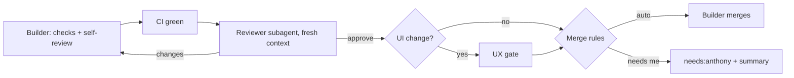

# Fleet: how agents work my backlogs

I am the product owner. Agents plan, build and review; I decide what gets built
and what merges. This file is the standard every repo in the fleet follows, and
every session loads it through the fleet plugin (see "Every session loads this file").

Plan and reasoning: the "Agent fleet plan" doc in the AI Assistant project.

## Where things live

- **Ideas** start in `brignano/ideas` (`inbox/` → `proposals/` → `building/`).
  A brief reaching `building/` is the signal to break it into issues.
- **Work items** are GitHub Issues in the repo that owns the code.
- **The board** is one GitHub Project, [**Fleet**](https://github.com/users/brignano/projects/1),
  across every fleet repo. Status columns: Proposed, Ready, Building, In review,
  Blocked, Done. Priority: P1, P2, P3. It is my view. Agents can't read or write it
  (cloud sessions only reach repo-scoped APIs), so **labels are what agents act
  on**, and `fleet-board` moves the cards to match them.
- **What's on the board** is listed in [`board.yml`](board.yml): driftwood,
  guidebook, sites, brignano.io, homelab, design, ai-tools and breakeven. The
  [`fleet-board`](../.github/workflows/fleet-board.yml) workflow adds every
  open issue and PR in those repos every 15 minutes, fills the board's Priority
  field from each card's `priority:` label,
  sets every open card's **Status from its labels** (see "Status, priority
  and blocked"), and flags stale claims (see "Claiming an
  issue"). It never removes a card,
  using the `FLEET_PROJECT_TOKEN` secret: a classic token with `project` and
  `repo` scopes. A repo earns a spot when agents ship work there and it has a
  real backlog. **life, people and ideas never go on the board.** The
  "By repo" view groups cards by Repository.

## Every session loads this file

Project instructions are set by hand per project and drift; this file doesn't.
So **the fleet plugin** loads this README and the global AGENTS.md into every
session, in every Claude Code project and thread. One edit here then reaches
every project.

- **The plugin is this repo.** [`.claude-plugin/plugin.json`](../.claude-plugin/plugin.json)
  makes the repo root a plugin named `fleet`: the skills in `skills/`, the
  subagents in `agents/`, the commands in `commands/`, and a start hook,
  [`plugin/session-start.sh`](plugin/session-start.sh), that prints AGENTS.md
  and the one-page [`ESSENTIALS.md`](ESSENTIALS.md). This full file is the
  `fleet-standard` skill, loaded only when a task needs it, so sessions start
  light. The hook reads from a fresh clone of `main`, so a merged rule reaches
  the next session without a rebuild. A changed skill, agent or command reaches
  cloud sessions when the plugin is uploaded again, and until then the hook
  tells me the uploaded copy is out of date.
- **Guards:** a PreToolUse hook, [`plugin/guard.py`](plugin/guard.py), blocks
  a push to `main`/`master` (force pushes included) and any write to a
  secrets file (`.env`, `.env.local`; templates like `.env.example` are fine),
  so those two hard rules hold without being remembered.
- **Stale check:** the zip carries `fleet/plugin/BUILD`, the content hash of
  its sources at build time. The start hook compares it with main's and, when
  they differ, has the session tell me once to re-upload.
- **Keep ESSENTIALS.md in step.** A PR that changes a rule here checks whether
  the one-line version in ESSENTIALS.md still holds, and fixes it in the same PR.
- **Shortcuts:** `/next` ("What's next"), `/handoff` ("Projects talk through
  issues"), `/merge-it` ("Merging when I ask"), `/new-repo` (the checklist below).
- **Cloud (every project):** installed once on my claude.ai account, under
  Customize > Plugins, from the `fleet-plugin.zip` on the
  [`fleet-plugin` release](https://github.com/brignano/ai-tools/releases/tag/fleet-plugin).
  The [`fleet-plugin`](../.github/workflows/fleet-plugin.yml) workflow
  rebuilds that zip on every merge; I upload it again when skills, agents or
  commands change.
- **My devices:** `install.sh` installs the same plugin from the local checkout
  (`claude plugin install fleet@brignano`), and it loads in place, so
  `ai-refresh` is all it takes to update it.
- **Why not the repo hook:** a project thread starts in a folder above its
  repos, so a repo's own `.claude/settings.json` hook never runs there. The
  old [`hook/`](hook/) still exists for repos that have it; it steps aside
  when the plugin is installed, so nothing loads twice.

**New repo checklist** (the planner's first run does this):

1. Nothing to install: the plugin already reaches it.
2. Labels arrive on their own: the `fleet-labels` workflow syncs every repo I
   own on Mondays. Run it by hand to get them sooner.
3. If it will have a real backlog, add it to [`board.yml`](board.yml).
4. Its project lists only the repos it owns. Work for another repo is an issue
   there (see "Projects talk through issues"), never a repo added to the project.

## Labels

One set in every repo, defined in [`labels.yml`](labels.yml). **Use only labels
from that file.** Never create a label from an issue or PR; if one is missing,
add it to `labels.yml` in a PR. The [`fleet-labels`](../.github/workflows/fleet-labels.yml)
workflow syncs the file to every repo I own on merge and every Monday
(`python3 fleet/sync-labels.py` previews it locally).

| Label | Meaning | Who sets it |
|---|---|---|
| `agent:working` | A session claimed it; every other session skips it. | The session that claims it |
| `agent:pause` | Leave it alone until I remove this. Holds an issue back from builders. | Me |
| `needs:anthony` | Blocked on a decision, account or hardware from me. | Any agent |
| `blocked` | Waiting on another issue or PR, named in a `Blocked by owner/repo#N` line in the body. | Any agent |
| `priority:p1` / `p2` / `p3` | Source of truth for priority; `fleet-board` copies it to the board's Priority field. Every open issue has one. | Whoever files it proposes, I confirm |
| `risk:low` / `risk:high` | Decides merge rules. | Planner proposes, I confirm |
| `size:s` / `size:m` | Agents take S and M only. Bigger gets split. | Planner |
| `type:bug` / `feature` / `chore` / `docs` | What kind of work it is. | Whoever files it |

Every issue an agent files carries one `priority:`, one `type:`,
one `size:` and one `risk:` label. No label marks an issue "ready": an open
issue that isn't held is ready (see "Ready by default"). Dependabot keeps its own (`dependencies`, `javascript`, …).

Default issue forms (task, bug, feature) are in [`issue-forms/`](issue-forms/)
and published to `brignano/.github` by [`bootstrap-dotgithub.sh`](bootstrap-dotgithub.sh).

## An issue is a spec

Every issue an agent writes uses this shape. It is what lets the builder work
without re-planning and the reviewer judge without asking me.

```markdown
## Problem
What is wrong or missing, and who it hurts. One paragraph.

## Acceptance criteria
- [ ] Observable outcome, checkable from the diff or a command
- [ ] ...

## How to verify
The exact commands or checks that prove it (the repo's own, e.g. `npm test`).

## Decisions
The calls the builder must not make. Approach (one, not options), files to
touch, existing code to reuse, and any choice a reasonable builder could make
two ways, already made. Written by the planner or me, never the builder.
Ends with "Do not decide:" listing what the builder must ask about instead.

## Out of scope
What this deliberately does not do.

## Notes
Files likely involved, links to the brief or TSD, risks.
```

**Decisions is required.** An issue filed on or after 2026-11-02 is held
(and sits in Proposed on the board) until its body has a `## Decisions`
section, so a builder never gets a spec with open design questions. Spec test for the planner: could a careful builder who has
never seen this repo implement it without choosing between two approaches?
If not, the missing choice goes in Decisions first.

Size S: the issue body is the spec. Size M: also a short proposal in the
repo's `proposals/`, linked from the issue, which I approve before anything is
built ("Design review before build"). Anything bigger is split before it is
Ready.

## Proposals

Design work lives in `proposals/` at the repo root, never in `docs/`. `docs/`
is for documentation a user reads (and a future doc site), and a proposal is a
decision record that may never ship. Keeping them apart means a doc site can be
built from `docs/` without dragging in rejected designs.

- **One file per proposal**, `proposals/<slug>.md`, starting with a status
  line: `Status: proposed | accepted | building | done | rejected`, and the
  issue that tracks it.
- **Every proposal has an issue.** The issue is the work item and the source
  of truth for whether it is Ready; the proposal is the reasoning behind it.
  A proposal with no issue is an orphan, and the reviewer rejects the PR that
  adds one.
- **`proposals/README.md` is the index**: one row per proposal with its
  status, tracking issue and the issues it was split into. Any PR that adds a
  proposal or changes its status updates the index in the same PR.
- A proposal that writes "proposed issues" at the end gets them filed by the
  planner once the proposal is `accepted`, and the index links them.
- `/new-tsd` drafts a proposal in this shape; save it as `proposals/<slug>.md`.

Index shape:

```markdown
# Proposals

| Proposal | Status | Issue | Split into | ADR |
|---|---|---|---|---|
| [AWS provider](aws-provider.md) | proposed | #41 | | |
```

**Lifecycle:** idea (`brignano/ideas`) → `proposals/<slug>.md` → an ADR in
`decisions/` when it is accepted or rejected → issues → build. The proposal
keeps the reasoning and the alternatives; the ADR is the one-screen record of
what was decided, and the index links the two.

**Definition of ready:** open and not held (see "Ready by default"), which
includes not claimed. If the spec is too thin to build from, the
builder doesn't guess: it comments the question, adds `needs:anthony`, and
stops.

**Definition of done:** every acceptance box ticked in the PR body, the repo's
checks green, the review gates passed (see "Review and merge"), and the PR
merged, by me or, where the merge rules allow it, by the builder.

## Design review before build

Building the wrong thing wastes more tokens than any other mistake, so design
is settled with me before code is written, and the build then does exactly
what was agreed.

1. **The proposal comes first, on its own.** Any size M issue, or any work
   whose Decisions can't settle every fork, starts with
   `proposals/<slug>.md` (`Status: proposed`) in a PR with **no code**.
2. **Then stop and explain it to me.** The agent adds `needs:anthony` to the
   issue and the proposal PR and posts a **Design review** in its thread (and
   as a PR comment), in plain words:
   - what will be built and what the user will see;
   - the approach in a few sentences, plus a Mermaid diagram if it has moving
     parts;
   - the options it rejected and why, one line each;
   - what it costs: build size (S/M), running cost, and maintenance;
   - every open question as a choice with a recommendation (a decision card
     where the app offers one).

   Then it ends its turn. Nothing else on that issue runs until I answer.
3. **My answer is the approval.** When I say yes (in the thread or on the
   PR), the agent pushes `Status: accepted`, the index row and the ADR onto
   the same proposal PR and merges it: my approval of the design counts as
   "merge it" for that PR. If I merged the proposal PR myself, it does the
   same in a small follow-up PR, which my approval also covers. Then it
   removes `needs:anthony` from the issue so it can be built. Changes I ask
   for go into the proposal and get a fresh Design review. A rejection sets
   `Status: rejected` with an ADR, the same way.
4. **Only then build.** The planner files the proposal's issues with their
   Decisions taken from the accepted proposal. A builder whose issue links a
   proposal that isn't `accepted` or `building` stops with `needs:anthony`.
5. **Say the plan before the code.** On every claimed issue, the builder's
   first comment is its plan: files it will touch, the steps, and what it
   won't do. If that plan departs from the issue's Decisions or the accepted
   proposal, it asks and stops instead of building.

Proposal and ADR PRs are never merged by an agent on its own say-so ("Who
merges").

## Decisions (ADRs)

A decision that lives only in a chat thread or an assistant's memory is lost to
every repo and agent that comes later. Each repo keeps its own decision log.

- **`decisions/` at the repo root**, never under `docs/` (same reason as
  proposals). One file per decision, `decisions/NNNN-slug.md`, numbered from
  `0001`, zero-padded, never renumbered.
- **`decisions/README.md` is the index**: one row per ADR with number, title,
  status and date. The PR that adds or supersedes an ADR updates it.
- **Shape, one screen:**

  ```markdown
  # NNNN: <the decision, as a statement>

  Status: accepted | superseded by NNNN
  Date: YYYY-MM-DD
  From: <proposal, issue or PR it came from>

  ## Context
  What forced a choice, and the options on the table.

  ## Decision
  What we chose, in a sentence or two.

  ## Consequences
  What this makes easier, harder, or rules out.
  ```

- **Never edited after merge**, except to mark it superseded. A changed mind is
  a new ADR that names the one it replaces.
- **Write one when** a proposal is accepted or rejected; a thread, issue or PR
  settles a choice a future reader would question (a tool picked, an approach
  rejected, something deliberately not built); or I decide against something.
  Whoever makes the call (planner, builder relaying my answer, me) writes it,
  in the PR that acts on it or a small PR of its own.
- **Not for:** routine implementation choices the code already explains.
- Existing proposals are not rewritten as ADRs. Back-fill an ADR only for a
  decision that is recorded nowhere in the repo today.

## Architecture

Diagrams are drawn from a model, never by hand, so they can be checked.

- **Every repo that deploys more than one moving part** (services, workers,
  sites with backends, actions, scheduled jobs) keeps a
  [driftwood](https://github.com/brignano/driftwood) model,
  `architecture.yaml`, at the repo root. A library, CLI or single static site
  doesn't need one.
- **CI validates and renders it**, so the picture can't drift from the model:

  ```bash
  npx @brignano/driftwood@0.10.0 validate architecture.yaml   # pin the version; bump it on purpose
  npx @brignano/driftwood@0.10.0 render architecture.yaml --engine mermaid -o docs/architecture.mmd
  git diff --exit-code docs/architecture.mmd   # fails when the committed render is stale
  # the page's first mermaid fence must match the render
  awk '/^```mermaid/{f=1;next} /^```/{if(f)exit} f' docs/architecture.md | diff - docs/architecture.mmd
  ```

  `docs/architecture.md` is the page people read: a few lines of prose and
  the diagram in a ```` ```mermaid ```` fence copied from `architecture.mmd`
  (GitHub draws it in place). Named views (`--view <id>`) can be rendered and
  embedded the same way when they are worth showing.
- **Where infrastructure is Terraform or CloudFormation**, also run
  `driftwood preview` on PRs and `reconcile` on demand, so the model is checked
  against what is deployed. Elsewhere the model is hand-written until driftwood
  has a provider for it (Docker Compose and Proxmox: brignano/driftwood#115).
- **The reviewer rejects** a PR that adds, removes or rewires a service or
  component without updating `architecture.yaml`.
- Mermaid in docs and proposals is still fine for flows and sequences; the
  system picture comes from the model.

## Where docs live

| Path | Holds | Published |
|---|---|---|
| `README.md` | The front door: what it is, how to start. | With the repo |
| `docs/` | What someone reads to use, run or operate it: guides, runbooks, `architecture.md`. | Yes, for public products |
| `proposals/` | Designs and specs, including rejected ones. | No, read on GitHub |
| `decisions/` | ADRs. | No, read on GitHub |

- **Private repos have no doc site.** GitHub renders Markdown and Mermaid,
  keeps it private, and costs nothing to run.
- **Public products** keep the product page at the root of their own site and
  serve user docs built from `docs/` at `/docs` on that same site (Astro
  Starlight by default, styled from `@brignano/design`, hosted per the
  `hosting` skill). The product's own issue can pick a different generator.
- **Not GitHub Pages:** on a private repo it needs a paid plan and publishes
  publicly, and it sits outside the Cloudflare and Access pattern every other
  site uses.

## Keep docs and context in sync

A change isn't done until everything that describes it says the same thing.
The next session only knows what the repo tells it, so stale docs or stale
agent context cost every future session time and get things built wrong.

Every PR updates, in the same PR, whatever its change makes untrue:

- **User-facing:** `README.md`, `docs/` (guides, runbooks,
  `architecture.md` and `architecture.yaml`), and the marketing or product
  site's copy, screenshots and feature lists.
- **Records:** the proposal's status and index row, and an ADR if a decision
  was made.
- **Agent context:** the repo's `AGENTS.md`/`CLAUDE.md`, its `.claude/`
  skills, commands and agents, and anything in brignano/ai-tools (skills,
  `AGENTS.md`, this standard) that describes the repo or the way it works.
  Add what a future session would otherwise have to rediscover: a new
  command, a gotcha, a path, a decision, a service.

If the thing to update lives in another repo (the marketing site, ai-tools),
file an issue there in the same session ("Projects talk through issues") and
link it from the PR. The PR body lists what it updated, or says
`Docs: none needed` with a reason.

## Ready by default

Everything in the backlog is ready for agents unless something says
otherwise. I don't label issues to approve them; I only label the exceptions.

- An open issue is ready, with no label to mark it, **unless it is held**:
  - `needs:anthony`: waiting on me;
  - `blocked`: waiting on other work;
  - `agent:pause`: I said leave it;
  - `agent:working`: already claimed;
  - `lead`, a `Release plan:` issue, or one opened by a bot;
  - opened by someone outside the repo (not me or a collaborator), because a
    builder treats the issue body as its spec. If I want one built, I open my
    own issue that links it;
  - filed on or after 2026-11-02 with no `## Decisions` section.
- When the hold comes off (I answer, the blocker closes, I remove the
  pause), the issue is ready again at once.
- A builder checks these itself before claiming; the board only shows them.
- Priority decides the order, so the only call I make on most issues is its
  `priority:`, and only when the proposed one is wrong.
- Builders still run only when I ask ("build the next ready issue"), and the
  merge rules below still decide what merges without me.

## Status, priority and blocked

I should be able to open the board, or ask any project "what's next", and see
at a glance what is moving, what is waiting on me and what comes next. So
every open issue carries enough labels to say all three, and the board
follows the labels.

**Status follows labels.** `fleet-board` sets each open card's Status every
15 minutes. Labels win over where a card sits. A held issue stays held until its hold comes off.

| Labels on the issue | Status |
|---|---|
| `blocked` or `needs:anthony` (beats everything below) | Blocked |
| `agent:working` and an open PR links it | In review |
| `agent:working` | Building |
| none of the above, not held | Ready |
| none of the above, held another way (no Decisions, bot, outsider, release plan) | Proposed |
| `agent:pause` or `lead` | left where I put it |
| closed | Done (GitHub's built-in workflow) |

Open PRs sit in In review. To unblock, remove the label; to hold one back, add
`agent:pause`. Dragging a card gets undone on the next sync.

**Every open issue has a priority.** Whoever files it proposes one; I change
it when I disagree. Priorities have to rank, or they say nothing:

- `priority:p1`: what this repo should do next. **At most 2 open per repo.**
  Adding a third means moving one down, in the same change.
- `priority:p2`: after that, this month.
- `priority:p3`: someday. Fine to have many, but a repo where every issue is
  P3 has no plan; its planner run fixes that first.

**Blocked has two kinds**, so I can tell what I owe from what is just queued:

- `needs:anthony`: only a person can move it (a decision, account, secret,
  hardware or a merge). The issue or PR says, in its last comment, exactly
  what I need to do, in one line.
- `blocked`: it waits on other work. The body has a `Blocked by
  owner/repo#N` line. When that closes, whoever closes it (or the next
  planner run) removes `blocked` from the issues it held up.

Something blocked on me *and* other work gets both.

**Backlog health.** Every Sunday, before the review, the
[`fleet-backlog-health`](../.github/workflows/fleet-backlog-health.yml)
workflow writes one "Fleet backlog health" issue in ai-tools, edited in
place each week. Per repo it lists: issues that are possibly done (a merged
PR mentions them, no open PR does), no priority, more than 2 P1s, `blocked`
with no "Blocked by" line, and idle for 30 days. It never changes the issues
themselves. The planner works through its repo's section first on every run,
and the Sunday review reads the whole thing.

## "What's next"

When I ask a project "what's next", "what should I work on", "what's in the
backlog" or "what's going on", the coordinator answers from GitHub, not from
memory of past threads. It reads every open issue and PR in its repo (and
its repo's section of "Fleet backlog health"), then answers in this order,
leaving out empty parts:

1. **Waiting on you**: `needs:anthony` issues and PRs, each with the one
   thing I need to do. PRs ready to merge first.
2. **In progress**: `agent:working` issues, with their thread or PR.
3. **Up next**: the top 5 issues that aren't held, by priority, then size,
   then age, with one line each on why. Offer to start the top one, or
   several in parallel threads.
4. **Held**: issues that would be ready but carry `agent:pause`, so I can
   lift a pause I forgot.
5. **Blocked**: `blocked` issues and what they wait on.
6. **Tidy-up**: issues that are possibly done (check the PR that mentions
   them, and offer to close the ones it finished) and issues with no priority (propose one).

It is a short list with issue links, not a wall of text. It may close an
issue that is possibly done, or set a missing priority, only after I say yes.

## Claiming an issue

Several projects pick up ready issues, so a session claims an issue
before it works on it. Without the claim two sessions can build the same thing.

- **Skip claimed issues.** Never start an issue labelled `agent:working`, even
  if I named it, unless I said to take over that claim. Say it is claimed and
  link the claim comment instead.
- **Claim before any work.** Re-read the issue's labels first (another
  session may have just claimed it). Then, in this order: add `agent:working`
  and comment:

  ```markdown
  Claimed by <session link> (<thread title>).
  ```

  The session link is the `https://claude.ai/code/session_…` URL from your
  commit attribution; if you don't have one, use the project thread link.
- **Link the PR to the issue** (`Closes #N` in the body) as soon as it opens,
  so the claim shows progress (see "Closing issues").
- **Release a claim you drop**: if you stop without a PR (spec question,
  blocked, I said stop), remove `agent:working`, comment why, and add
  `needs:anthony` if it needs me. Never leave a
  silent claim.
- **The board follows the claim.** `fleet-board` moves an `agent:working`
  card to **Building**. A claim more than 24 hours old with no open PR linked
  to the issue gets `needs:anthony` and one comment, so a stuck session can't
  block it. To release it, I remove `agent:working` and `needs:anthony`.

## Closing issues

An issue closes when its work merges, without anyone remembering to do it.

- **Every PR that works on an issue links it in its body**, whether or not a
  builder run started it:
  - `Closes #N` (or `Closes owner/repo#N` across repos) when merging it
    finishes the issue. GitHub closes the issue on merge.
  - `Part of #N` when it does only some of the work. The PR body then says
    what is left, and the issue gets a comment saying the same.
  A bare `#N` is not enough: it links without closing, so the issue sits open
  after the work is done.
- **The reviewer checks it**: a PR that mentions an issue without `Closes`
  or `Part of`, or says `Closes` while acceptance boxes are unticked, gets
  `CHANGES`.
- **Done any other way** (fixed by a commit with no issue link, made
  obsolete, duplicated): close it with a one-line comment saying why, as
  `completed` or `not planned`.
- The Sunday backlog health issue lists anything that still slips through as
  "Possibly done", and "what's next" offers to close it.

## Roles and models

Plan on the strong model, build on the cheaper one. Same rule as the global
AGENTS.md "Planning & delegation".

| Role | Model | Runs | Prompt |
|---|---|---|---|
| Planner | Opus | When I ask, in the repo's project | [`roles/planner.md`](roles/planner.md) |
| Builder | Sonnet; Haiku for searches and test runs | When I ask, in the repo's project | [`roles/builder.md`](roles/builder.md) |
| Reviewer | Opus, fresh context | **Automatically**, started by the builder once CI is green | [`roles/reviewer.md`](roles/reviewer.md), as the [`reviewer`](../agents/reviewer.md) subagent |

**Deciders decide, builders execute.** Every judgment call (approach,
trade-offs, scope, what an ambiguous requirement means) is made by a thread on
Opus: the planner, the coordinator, or me. A builder thread on a cheaper model
only carries out the issue's Decisions section. If it hits a fork the spec
doesn't settle, it does not choose: it comments the question and the options
it sees on the issue, adds `needs:anthony`, removes `agent:working` and
stops. The coordinator (or planner) answers by editing Decisions, then the
issue is picked up again. Starting a thread, the coordinator states the role
and model (Opus for plan, review, debugging an unknown cause and anything
without a Decisions section; Sonnet for a build with Decisions; Haiku for
searches and test runs). A build request for an issue with no Decisions
section is routed to the planner first.

**How it is enforced.** `claude/settings.json` sets `"model": "opusplan"`, so
main sessions on my devices plan on Opus (plan mode) and do everything else on
Sonnet. Override one session with `/model opus` or `/model sonnet`. Subagents
keep their own `model:` frontmatter. The `implementer` runs with
`isolation: worktree`, so each step is committed on its own worktree branch (from the
planner's committed HEAD) and the planner reviews that diff before merging the branch. Cloud sessions take their model from the
claude.ai project or thread, not a settings file; the coordinator pins it by role.

Nothing runs on a schedule. The reviewer is the exception to "when I ask":
no PR waits for me to request a review (see "Review and merge"). I start a role from the repo's own Claude project
("build the next ready issue", "review the open PR", "plan driftwood") and say
which role; the thread doing the work reads its prompt from `roles/`. New ideas
are planned in the Life project, and an idea that starts being built gets its
own project.

The builder takes the Ready item with the highest `priority:` label, then the
smallest, then the oldest. When I just say "build the next ready issue", one
open builder PR per repo at a time. When I name specific issues, each gets its
own thread and they may run in parallel.

## Projects orchestrate, threads do one thing

Each repo's Claude project is run by its coordinator (the project chat). The
coordinator is the **orchestrator**: it plans, routes and keeps track, but it
does not do the work itself. Work happens in threads, **one thread per issue or
PR**, so every thread's context is about one thing and I can run several side
by side.

- **Start a fresh thread for each issue or PR.** When I ask for work on an
  issue, a PR, a role run on one item, or anything that will end in a PR, the
  coordinator starts a new thread for it instead of doing it in the project
  chat or in an existing thread. Several issues means several threads.
- **Title the thread after the item**, in plain words plus the number, for
  example "Fix login redirect loop (#42)". A role run that is not about one
  item yet ("plan driftwood", "review open PRs") gets its own thread too, and
  any issue it turns into a build gets a thread of its own.
- **One item per thread.** If a thread uncovers new work, it files an issue
  in the repo that owns that work (see "Projects talk through
  issues") and tells the coordinator; it does not start the new work itself. Follow-ups on the same issue or its PR (review fixes, CI, my
  comments) stay in that thread.
- **A thread ends when its item does**: the PR merges, or the issue closes or
  is dropped. Then the thread is resolved. It stays open while it is waiting
  on me, a review or CI.
- **The coordinator keeps the overview**: which threads are running, which are
  waiting on me, and what is next. When I ask "what's going on" or "what's
  next", it answers as the "What's next" section says, from the issues, its threads
  and the labels, without pulling their work into the chat.
- Short questions that change no code (a status check, "what does X do") can
  be answered in the project chat without a thread.

## Projects talk through issues

Projects can't see each other: a session in one project has no way to reach
another project's chat or threads. **GitHub issues are how projects hand each
other work.** Each project already picks up its own repo's issues, so an issue
in the right repo is the message.

- **Work that belongs to another repo goes in an issue there.** When a thread
  finds that a fix, feature or decision lives in another repo (driftwood needs
  a token in `design`, `sites` needs a route in `homelab`), it opens an issue
  in *that* repo instead of doing the work here.
- **Don't ask me to add the other repo to this project** so you can work in it,
  and don't tell me you can't reach the other project. Attach the repo to the
  session only as far as filing the issue needs; never save it to the project
  and never push to it.
- **The issue is a normal spec**: the spec shape above, one `priority:`,
  `type:`, `size:` and `risk:` label from `labels.yml`. Say which repo and
  issue or PR it came from (`From brignano/driftwood#42`), so the other side
  has the why. Add `needs:anthony` only when a person must act first: an
  account, a secret, hardware, or a decision between options.
- **If your work waits on it**, say so where your work lives: a line on your
  issue or PR, `Blocked by brignano/design#12`, add `blocked` to your issue,
  and leave your thread open.
  Don't build a workaround that the other repo's fix will undo.
- **Tell me in one line**, in the thread: "Filed brignano/design#12 for the
  design project." That's all. It is ready like any other issue,
  and the other project builds it in priority order.
- **Only when it's urgent** (it blocks something I asked for today, or
  something is broken in production) add: "Start a session in the **design**
  project for #12." Otherwise don't send me to another project.
- **Never for personal topics.** Nothing from `life` or `people` goes into an
  issue, and no project files issues in `life`, `people` or `ideas`. A new
  product idea goes to me in the Life project, not into an issue.

## Releases are planned, not per change

A merged PR is not a release, and a version number is not a progress counter.
Agents batch merged work into **planned releases**, and I cut them (the
`releases` skill covers how). Driftwood went 0.4.0, 0.5.0, 0.6.0 in two days and
breakeven shipped eight versions in one; nobody reading a release page wants that.

- **No PR bumps a version.** Builders never touch `version` in `package.json`
  or a manifest, run `npm version` / `release:version`, add a CHANGELOG, or end
  a PR by suggesting a release. The version moves only in the PR that prepares
  a release I have agreed to cut, and only where the repo needs one (driftwood
  takes it from the tag, so there it never moves).
- **Every PR says what it means for the next release**, at the end of its body:

  ```markdown
  ## Release
  Impact: none | patch | minor | major
  Note: One line for someone reading the release page, or "none".
  ```

  This is raw material, not a decision. `none` is for CI, refactors, tests and
  docs a user never sees.
- **One open release plan per repo**: an issue titled
  `Release plan: vX.Y.Z — <theme>`, labelled `agent:pause` and
  `type:chore`, pinned. The planner keeps it current. The pause (and its
  title) hold it, so no builder takes it. Its body:

  ```markdown
  ## Theme
  What this release lets someone do that they couldn't before. One sentence.

  ## Scope
  - [ ] #12 Plan preview for CloudFormation (in progress)
  - [x] #15 Fix module key resolution (merged #18)

  ## Already merged since vX.Y.Z
  PRs whose Release impact is not none, grouped by impact.

  ## Version
  vX.Y.Z, because <the highest impact in scope>.

  ## Draft notes
  The release page body, written per the `releases` skill.
  ```

- **The version follows the batch.** Take the highest impact in the release:
  breaking → major, new capability → minor, fixes only → patch. Below 1.0 a
  breaking change is a minor, not a major. A repo's own rule wins (design: the minor is for tokens that look
  different, not plumbing).
- **I approve the scope.** The planner proposes the theme and scope; I edit the
  issue or answer it. Work I add mid-way joins the plan; work that doesn't fit
  the theme waits for the next one.
- **Propose a cut when the theme is done**: every scope box ticked, checks
  green on the default branch. Then the planner finalises the notes, adds
  `needs:anthony`, and says "ready to cut vX.Y.Z" in its run summary. Two
  exceptions cut sooner as a patch with only what is needed: a security fix,
  and a fix for something the last release broke.
- **Nothing ready, nothing cut.** If two weeks of user-facing work has merged
  with no theme finished, the planner says so and offers to cut what is there,
  but does not push.
- After I publish, the next planner run closes the plan (the tag exists) and
  opens the next one, carrying over unfinished scope.
- Repos that deploy on merge and have no release page (brignano.io, sites,
  homelab) don't version: no bumps, no plan, and the `## Release` section can
  be left out.

## Asking Anthony

Every ask stands on its own. This applies to every role and every channel: a
`needs:anthony` comment, a thread reply, a decision card and a Ready to merge
comment. I should be able to answer from that one message, on a phone, without
opening the issue, the PR or the thread. This is the only place the format is
defined; roles link here and don't restate it.

- **Lead with the ask**, in plain words: what you need from me and by when it
  matters (what is blocked until I answer).
- **Never a bare count.** "3 decisions left" or "make the last 2 decisions
  before merging" is not allowed on its own. A count may head a list that
  spells every item out.
- **One block per decision**, numbered, in this shape:

  ```markdown
  ### Decision 1 of N: <the question, in plain words>
  Context: <what this is about and why it came up, 1-2 sentences>
  Options:
  - A (recommended): <what it is> → <what happens / cost / risk>
  - B: <what it is> → <what happens / cost / risk>
  Why I recommend A: <one sentence>
  Reply with: "1A" (or your own answer)
  ```

- **Every decision carries a recommendation.** If you truly have none, say why
  in the "Why I recommend" line.
- **Reply codes** (`1A`, `2B`) let me answer several decisions in one line.
- **A PR with an open decision is not ready.** Put the decision to me first;
  don't post Ready to merge with questions still open.
- Post the full block wherever you ask (issue comment, thread, card), not a
  link to somewhere else that holds it.

## Review and merge

Every PR an agent opens goes through the same gates, in the same order, in the
thread that built it, whether or not it came from a builder run. **No PR waits on me to ask for a review**: the builder runs the
whole pipeline and only comes to me with a PR that is either merged (where the
merge rules allow it) or ready for my merge with the review already done, so
that "merge it" from me is a one-line ask that works first time.



1. **Self-review** (builder). Run the repo's checks and the issue's "How to
   verify", then the `code-review` skill on your own diff at `medium` and
   `simplify` on what you changed. Fix what they find before opening the PR.
2. **CI green.** The repo's required checks pass on the PR's head. A repo with
   no CI gets an issue to add one; until then, paste the local check
   output in the PR body.
3. **Reviewer pass** (independent). Once CI is green, the builder starts the
   [`reviewer`](../agents/reviewer.md) subagent with only the PR number and
   the issue: no summary of what it did, so the review isn't anchored on the
   builder's view. It reviews spec, correctness, security, tests, scope and
   simplicity (checklist in [`roles/reviewer.md`](roles/reviewer.md)) and
   returns `APPROVE` or `CHANGES` with file, line and fix.
   - The builder posts the verdict as a PR comment headed
     `Reviewer: APPROVE` or `Reviewer: CHANGES` with the head SHA. (Every
     agent posts as me on GitHub, and GitHub won't let me approve my own PR,
     so this comment is the approval.)
   - On `CHANGES`, the builder fixes and runs the reviewer again on the new
     head. After two rounds still not approved: `needs:anthony`, stop.
   - Review comments from people or bots on the PR are answered or fixed
     before the reviewer runs again.
4. **UX gate**, only for PRs that change what a user sees (pages, components,
   styles, copy, emails). Follow the [`ux-review`](../skills/ux-review/SKILL.md)
   skill: the repo's `ui-check` job (the reusable
   [`ui-check`](../.github/workflows/ui-check.yml) workflow) must pass with no
   serious or critical accessibility violations, and the PR body carries
   mobile and desktop screenshots, light and dark. The reviewer checks the
   skill's list against the diff.
5. **Merge**, by the rules below.

### Preview links

I review on my phone, so a PR that changes a site is not ready until I can
tap a link and see it. For any PR on a repo with a deployable site:

1. **Wait for the preview of the current head.** The host builds one per
   branch (table below). Read the URL from the host's bot comment or check
   run, and confirm the commit it names is the PR's head SHA. A preview that
   failed to build is a failing check: fix it like CI.
2. **Put it at the top of the PR body**, kept current on every new head:

   ```markdown
   ## Preview
   [Open the preview](<branch preview URL>) · head <short sha>
   - [<page name>](<preview URL>/<path>): <what changed there, a few words>
   ```

   One bullet per page the diff changes, as a direct link to that path on
   the preview (work out the route from the files changed). List at most 8,
   most important first; say "and N more" past that.
3. **Put the same links in the thread reply** that hands me the PR, and in
   the `Preview:` line of the Ready to merge comment.
4. **Use the branch link**, not a per-commit one: it keeps working after the
   next push. Per-commit links are only for comparing two versions.
5. **No preview possible?** Write `Preview: none (<why>)` and put
   screenshots or a GIF in the PR body instead (the UX gate already asks for
   them). If the repo deploys a site but gives PRs no preview, file an
   issue there to add one.

Every preview is private to me: Vercel previews ask me to sign in to Vercel,
`*.workers.dev` previews to Cloudflare Access (one-time PIN). Never make a
preview public to save me a sign-in.

| Repo | Host | Where the preview link comes from |
|---|---|---|
| brignano.io | Vercel | `vercel[bot]` comment, **Preview** column |
| guidebook | Vercel (`packages/site`) | `vercel[bot]` comment, **Preview** column |
| driftwood | Cloudflare Workers Builds | `cloudflare-workers-and-pages[bot]` comment, "Preview URL" |
| hoststats | Cloudflare Workers Builds | `cloudflare-workers-and-pages[bot]` comment, "Preview URL" |
| sites | GitHub Actions (`Deploy sites`) | the run's summary table, one link per changed site; none for a brand-new site or the editor |
| design | Cloudflare Workers Builds | `cloudflare-workers-and-pages[bot]` comment, "Preview URL" |
| card, breakeven | not web (CLI, desktop app) | screenshots or the demo GIF |
| homelab | not a public site | `Preview: none (deploys on CT 100)` |

Keep this table current when a repo's hosting changes.

### Who merges

A PR **may be merged by the builder** only when every one of these holds:

- The repo is listed under `auto` in [`merge.yml`](merge.yml). I add repos
  there; agents never do.
- Its issue was ready (not held) when it was claimed, so it
  now carries `agent:working` and a claim comment, plus `risk:low` and
  `size:s` or `size:m`.
- CI is green and the latest `Reviewer: APPROVE` comment names the current
  head SHA. No unresolved review threads, no `agent:pause` or `needs:anthony`.
- The UX gate passed, if it applies.
- The diff touches none of the protected areas: CI workflows; secrets, `.env`
  or credentials; auth, access or hosting config; infrastructure or deploy
  config; dependency manifests or lockfiles (Dependabot and Renovate PRs
  included); data migrations or anything that deletes data; versions,
  changelogs or release notes; agent rules (`AGENTS.md`, `CLAUDE.md`,
  `.claude/`); proposals and decisions (`proposals/`, `decisions/`), except
  the accept or reject PR my design approval covers ("Design review before
  build"); and anything the repo's own AGENTS.md lists as protected.

Then the builder squash-merges, deletes the branch, and tells me in one line
in the thread: what merged and the PR link.

**Everything else waits for me**, already reviewed. The builder adds
`needs:anthony` and posts a **Ready to merge** comment on the PR, kept current
on every new head:

```markdown
## Ready to merge
Head: <sha> · CI green · Reviewer: APPROVE · UX gate: passed | n/a
Preview: <link to the preview of this head> | none (<why>)
Up to with <base>: yes · Conflicts: none
What changed: <one or two lines>
What you're approving: <the user-visible or system effect, in plain words>
Risk: <what could break and how it would show up>
Decisions made in this PR: <each decision, one line, with a link to where it was decided> | none
Why it needs Anthony: <the "Who merges" rule it misses>
After merge: <what deploys or runs, and how it will be checked>
```

What you're approving, Risk and Decisions made in this PR follow "Asking Anthony":
I must be able to approve from this comment alone. If a decision is still open, the PR isn't ready: ask it
first, in that shape.

A PR is only "ready" when every line is true for its current head. A new
push, a base branch that moved, or a new review comment makes it not ready
until the gates run again on the new head.

### Merging when I ask

The point of the gates is that when I say "merge it" (or "merge #N") in any
Claude session, it just works. That ask is my approval for that PR, whatever
`merge.yml` says. The session then:

1. Reads the PR at its current head. If the Ready to merge comment doesn't
   match the head, or anything else changed since (new commits, base moved,
   new comments, CI not green), it runs the missing gates first: bring the
   branch up to date with the base, wait for CI, re-run the reviewer on the
   new head. It does not ask me to wait or to re-confirm unless a gate fails.
2. Merges with the repo's merge method (squash by default) and deletes the
   branch.
3. Checks the result: CI on the default branch after the merge, and the
   deploy if the repo deploys on merge. It tells me in one line that it
   merged and that main is green, or what broke.
   **Homelab deploys** (homelab itself, or anything that runs on CT 100):
   cloud sessions can't reach the box. The PR body gets a `## Deploy` section
   and the merge reply ends with the same thing: whether CT 100 picks it up
   automatically (homelab's auto-deploy, brignano/homelab#335, once it ships)
   and the one line I paste into a terminal on the Mac or Windows to run it
   myself, in a code block, naming the stack the change touched:

   ```sh
   hl-ssh -t "cd /root/homelab && claude '/deploy monitoring'"
   ```

   `hl-ssh` connects to CT 100, `-t` keeps the session interactive, and
   `/deploy` is the homelab repo's deploy command (no stack = every stack).
   If the change needs something `/deploy` doesn't cover (a new `.env` key, a
   host step), say so above the line. Never just say "run /deploy".
4. If a gate fails, it doesn't merge. It says in one line what failed and
   what it's doing about it, fixes what it can in the PR, and merges once
   green without asking again.

A merge I asked for still never skips a gate, and never covers a release,
tag or publish (those need "publish X").

## Leads

Any project that takes in leads (contact, signup, pilot or preview-request
forms) follows this one standard. Edit it here and every project's agents pick
it up on their next session; the `leads` skill is the checklist they work from.
Reference implementation: `brignano/sites` (PRs #31 to #33).

**Store the lead first. Every later step is best-effort: wrap each in its own
try/catch, log the failure, and never let one block, slow or fail the form or
the saved lead.** The stored record is the source of truth.

1. **Store the lead** (KV, DB or file) with the full details. Keep this behind
   one small function so the store can move to a central service later.
2. **Email me** via Resend, from `<project>@<domain>`, with a link to the
   stored record. This is the fast ping.
3. **Auto-reply to the lead** from `hello@<domain>`: designed HTML plus a
   plain-text part, dark-mode aware, a fixed template (no per-lead generated
   text), at most one per address per week. I approve the wording before it
   ships. The reply window it promises (say "within two days") is the window
   the nudge enforces.
4. **Track it in GitHub**: one issue per lead, label `lead`, assigned to me,
   closed when replied to. Title is `Lead: <company or name>` only. The body
   links to the stored record and holds **no email, phone number or message
   text**: issues are not private enough and a repo may be public. Write the
   promised window in the body (for example "Reply within 2 days") so the nudge
   matches it.

A daily Action calls the reusable
[`lead-nudge`](../.github/workflows/lead-nudge.yml) workflow
(caller to copy: [`leads/lead-nudge-caller.yml`](leads/lead-nudge-caller.yml)).
It `@mentions` the assignee on `lead` issues open more than 24 hours, and again
with stronger wording once the promised window (`promise_hours`) has passed.
Changing the nudge here changes it for every project, because callers point at
`@main`.

**Needs, per project** (a new form without these is incomplete):

- Sending domain verified in Resend (DNS records) before the feature ships, and
  `RESEND_API_KEY` in the platform's secret store.
- `GITHUB_TOKEN`: the variable name every project's host uses (sites already
  does), holding a fine-grained token with Issues read/write on the repos that
  take leads. It expires yearly. A new lead-taking repo is **added to the
  token's repo list**; don't mint a token per project. A project that also
  needs Contents write (sites commits editor changes) keeps its own token under
  the same name. Set it in the host (Cloudflare Worker, Vercel), never as a
  GitHub Actions secret: Actions reserves the name for its own token, and the
  nudge workflow needs no secret.
- The `lead` label arrives from `labels.yml` like any other. Do not invent one.

**Agents leave leads alone.** `lead` issues are not work: `lead` holds them, a builder never takes one, and a planner never proposes
or re-labels them. They can sit on the Fleet board so I see them, but they are
only ever handled by me replying and closing.

## Hard rules for every agent

- Never push to the default branch. Work on a branch, open a PR.
- Never merge a PR unless I asked for that PR to be merged or "Who merges" allows it, and never release, tag or publish without my explicit "publish X" for that version. Drafting the notes PR is fine (see the `releases` skill).
- Never add a repo to `merge.yml`, and never skip, disable or weaken a check or test to get a PR through the gates.
- Never bump a version outside a release I agreed to cut (see "Releases are planned").
- Never touch secrets or `.env` files, and never widen your own permissions.
- Never remove `agent:pause`, and never work on, label or close a `lead` issue.
- Never work on an issue another session has claimed (`agent:working`).
- Never re-plan a Ready issue. If the spec is wrong, comment the question, add
  `needs:anthony`, remove `agent:working`, and stop.
- Respect `agent:pause` on an issue and any repo rule in its own AGENTS.md;
  the repo's rules win over this file where they are stricter.
- Personal topics (the `life` and `people` repos) never go into issues or PRs.
